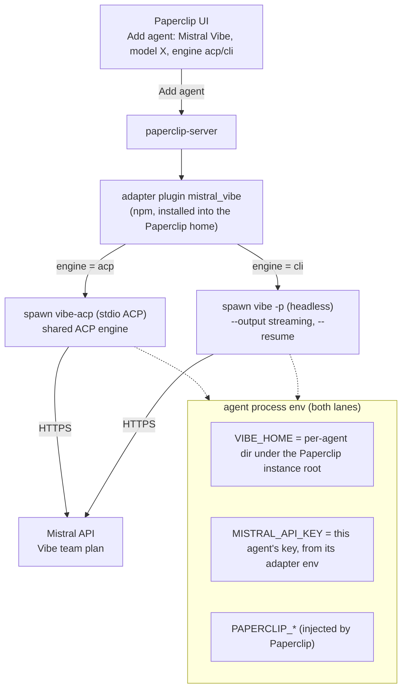

# paperclip-adapter-mistral-vibe

External adapter plugin that runs [Mistral Vibe](https://github.com/mistralai/mistral-vibe) agents in [Paperclip](https://paperclip.ing), either over ACP (`vibe-acp`) or headless via the `vibe` CLI (`vibe -p`). Per-agent **Execution engine** setting picks the lane.

- Adapter type key: `mistral_vibe` (label: **Mistral Vibe**)
- License: MIT
- Runs each agent with its **own Vibe state** (`VIBE_HOME`) and its **own Mistral API key**, so several Vibe agents can run concurrently.
- Thin by design: the `acp` lane delegates to Paperclip's shared ACP engine (`@paperclipai/adapter-utils/acpx-engine`) with `agent: "custom"` and `agentCommand: <vibe-acp path>`; the `cli` lane spawns `vibe -p` directly and maps its NDJSON stream to the run transcript.

## Execution engines

The agent config's **Execution engine** field (`engine`) picks one of two lanes; the Paperclip form shows only the fields for the selected engine:

| | `acp` (default) | `cli` |
|---|---|---|
| Process | standalone `vibe-acp` binary via Paperclip's shared ACP engine | one `vibe -p` process per run |
| Interactive approval | Yes — permission requests surface in the Paperclip UI | No — decided up front by the `cliAgent` profile (default `auto-approve`); unanswered callbacks are auto-denied and logged |
| Sessions | ACP engine session codec across heartbeats | `--resume <id>`, stored per agent in `VIBE_HOME`; failed resume falls back to a fresh session |
| Usage / cost | ACP stream | vibe's per-run `export.json` (`usageBasis: per_run`) |
| Node requirement | Node >= 24.11 (shared ACP engine) | none beyond the Paperclip server itself |

The CLI lane needs the `vibe` binary (`uv tool install mistral-vibe` installs `vibe` and `vibe-acp` side by side). Resolution: `vibeCliPath` → `PAPERCLIP_VIBE_CLI_PATH` → `vibe` on `PATH`. Both lanes share the per-agent `VIBE_HOME` isolation model, the `config.toml` model seeding, and the workspace-trust seed.

## How it works



Isolation guarantees:

- **Per-agent state.** Every agent gets its own `VIBE_HOME` (default: `<paperclip instance root>/companies/<companyId>/mistral-vibe/agents/<agentId>/home`). Config, `.env`, session logs, caches and history never collide, so concurrent agents never corrupt each other (the failure mode that sank upstream PR #8378).
- **Per-agent credential.** The agent's `MISTRAL_API_KEY` is passed only to that agent's `vibe-acp` process through the run environment. Do **not** put the key in the container-wide environment (`/etc/secrets/paperclip.env`) — every Claude/Codex/OpenCode process would inherit it.
- **Workspace trust.** Neither ACP clients nor headless `-p` runs can answer Vibe's interactive workspace-trust prompt, so the adapter seeds the run's working directory into the agent's own `trusted_folders.toml` before launch (the `cli` lane additionally passes `--trust` per invocation).
- **Model plumbing.** The adapter writes the selected model into the agent's `VIBE_HOME/config.toml` (`active_model` + a `[[models]]` alias entry), so `vibe-acp` accepts the model the ACP engine selects via `session/set_config_option`, and the `cli` lane runs on the same active model.

## Prerequisites

1. **The Vibe runtime for your engine** (pick per agent, see [Execution engines](#execution-engines)):

   **`acp` lane — standalone `vibe-acp` binary.** Download `vibe-acp-<platform>-<version>.tar.gz` from the [mistral-vibe releases](https://github.com/mistralai/mistral-vibe/releases) (e.g. `vibe-acp-linux-aarch64-3.0.2.tar.gz`, ~72 MB). It is self-contained (bundles its own Python), so it needs nothing from the host. Extract it somewhere stable, e.g.:

   ```sh
   mkdir -p /opt/vibe-acp
   tar -xzf vibe-acp-linux-aarch64-3.0.2.tar.gz -C /opt/vibe-acp
   /opt/vibe-acp/vibe-acp --version   # → vibe-acp 3.0.2
   ```

   **`cli` lane — the `vibe` CLI.** Install the `mistral-vibe` package; it registers the `vibe`, `vibe-acp` and `vibe-app-server` console scripts side by side (so one install serves both lanes):

   ```sh
   # uv (recommended; needs a GIL-enabled Python 3.12+)
   uv tool install mistral-vibe
   ~/.local/bin/vibe --version        # → vibe 2.26.1
   ```

   Alternatively download the release tarball from the [mistral-vibe releases](https://github.com/mistralai/mistral-vibe/releases) and put `vibe` on `PATH`. Unlike the standalone `vibe-acp` binary, the CLI depends on the host Python environment — keep the tool installed and up to date (`uv tool upgrade mistral-vibe`).

2. **A Mistral API key** created under **Code › Vibe CLI** in the [Mistral console](https://console.mistral.ai). Usage draws from the plan's included quota first; pay-as-you-go is off by default.

3. **Node >= 24.11** for the Paperclip server — only for the `acp` lane (required by the shared ACP engine in `@paperclipai/adapter-utils`). The `cli` lane has no extra server requirement. The environment test checks this per engine.

## Install the adapter

In Paperclip: **Settings → Adapters → Install from npm**, enter `paperclip-adapter-mistral-vibe`.

Or via the API: `POST /api/adapters` with `{ "packageName": "paperclip-adapter-mistral-vibe" }`.

## Point Paperclip at the binary

Resolution order per engine:

| Engine | 1. agent config | 2. server environment | 3. fallback |
|---|---|---|---|
| `acp` | `vibeAcpPath` | `PAPERCLIP_VIBE_ACP_PATH` | `vibe-acp` on `PATH` |
| `cli` | `vibeCliPath` | `PAPERCLIP_VIBE_CLI_PATH` | `vibe` on `PATH` |

## Add an agent

**Add agent → Mistral Vibe**, then configure:

| Field | Value |
|---|---|
| Execution engine | `acp` (default) or `cli` — the form swaps its lane-specific fields |
| Model | e.g. `mistral-medium-latest` (default), `mistral-large-latest`, `mistral-small-latest`, `codestral-latest`, `zai-glm-5-3`, … |
| env | `MISTRAL_API_KEY=<your key>` — a Paperclip **secret reference** is supported and recommended |
| vibeAcpPath | `/opt/vibe-acp/vibe-acp` (acp lane; optional if the binary is on `PATH` or `PAPERCLIP_VIBE_ACP_PATH` is set) |
| vibeCliPath | e.g. `/home/vibe/.local/bin/vibe` (cli lane; optional if `vibe` is on `PATH` or `PAPERCLIP_VIBE_CLI_PATH` is set) |
| cliAgent | `auto-approve` (default) / `smart-approve` / `accept-edits` / `default` (cli lane) |

Run **Test environment** on the agent. The test branches on the engine and checks:

- `acp`: Node >= 24.11 (ACP engine requirement), `vibe-acp` resolvable and `--version` reported
- `cli`: `vibe` resolvable and `--version` reported (no ACP Node requirement)
- both: `VIBE_HOME` resolvable and writable, `MISTRAL_API_KEY` present (in the agent env or `$VIBE_HOME/.env`) — presence only, the value is never printed, and the optional live auth probe: `GET https://api.mistral.ai/v1/models` with the agent's key (disable with `vibeAuthProbe: false`)

## Quota dashboard (optional)

Runs draw from the **Vibe plan's included monthly usage** (shared across Studio, the API, and Vibe Code for the plan); pay-as-you-go applies only if the org enables it. Paperclip's per-run token tracking always works.

To surface the **remaining Vibe budget** in Paperclip's quota dashboard, set `MISTRAL_ADMIN_API_KEY` on the **Paperclip server process** (not per agent) to a Mistral **Admin API key** created in the Admin Panel. The adapter's `getQuotaWindows()` then queries:

- `GET https://api.mistral.ai/v1/admin/usage?month=<m>&year=<y>` — org consumption by category, including the dedicated `vibe_usage` category
- `GET https://api.mistral.ai/v1/admin/spend-limit` — the org monthly spending limit

and reports a **"Vibe monthly spend"** window: percent of the org monthly limit consumed, resetting at the end of the billing period. Without the server-side key, the quota row is simply absent.

Caveats:

- The Admin API is **Enterprise-only**; a standard Code › Vibe CLI plan key does **not** work on admin endpoints.
- The admin key is read from the server process environment only — it is never logged and never passed to agent runs.
- Whether a **Team** plan's Vibe budget is per-seat or org-shared is unverified (Mistral docs don't say); confirm before relying on the percentage.

## Configuration reference

See `agentConfigurationDoc` in the adapter (rendered in the Paperclip UI) for the full list. Highlights:

- `model` (string): Mistral API model id. Default `mistral-medium-latest`.
- `engine` (string): `acp` (default) | `cli` — see Execution engines above.
- `vibeAcpPath` (string, acp): absolute path to the `vibe-acp` binary.
- `vibeCliPath` (string, cli): absolute path to the `vibe` binary (`PAPERCLIP_VIBE_CLI_PATH`, then `PATH`).
- `cliAgent` (string, cli): `auto-approve` (default) | `smart-approve` | `accept-edits` | `default`.
- `cliFreshSession` (boolean, cli, default false): start a new vibe session instead of resuming.
- `env` (object): `KEY=VALUE` variables for the agent process. `MISTRAL_API_KEY` belongs here. `VIBE_HOME` is always set per agent by the adapter and overrides any value here.
- `vibeHome` (string): absolute `VIBE_HOME` override for this agent.
- `vibeAuthProbe` (boolean, default `true`): live auth probe in the environment test.
- `cwd`, `instructionsFilePath`, `promptTemplate`, `timeoutSec`, `graceSec`, `mode`, `permissionMode`, `nonInteractivePermissions`, `warmHandleIdleMs`.

Notes:

- `effort` / `thinkingEffort` / `fastMode` are **not** forwarded: `vibe-acp` rejects them as unsupported config options.
- `acp` lane: sessions resume across heartbeats via the shared ACP engine's session codec. Changing the agent's env (including the key) starts a fresh session.
- `cli` lane: sessions resume via `--resume <id>`, stored per agent in `$VIBE_HOME/paperclip-cli-session.json` (survives server restarts). A failed resume logs a `[paperclip]` note and falls back to a fresh session; `cliFreshSession: true` forces a new session. Unanswered approval callbacks are auto-denied with a transcript notice — the lane is policy-based (`cliAgent`), not interactive.

## Development

```sh
npm install
npm run build     # tsc → dist/
npm test          # node --test smoke tests against dist/
```

The `./ui-parser` export (`dist/ui-parser.js`) is self-contained (zero runtime imports) and served to the browser for run-transcript rendering. Its engine-line mapping is adapted from `parseAcpxStdoutLine` in `@paperclipai/adapter-utils` (Paperclip is MIT-licensed).

## License

MIT — see [LICENSE](./LICENSE).
